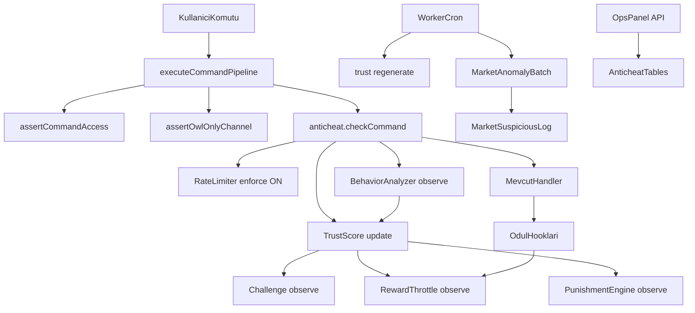

# OwlHunt Anti-Cheat Entegrasyon Planı

## Adım 0 — Keşif Özeti (doğrulanmış)

| Konu | Gerçek durum |
|------|----------------|
| Dil / runtime | **TypeScript** (`tsconfig.json`), Node **>=20**, üretimde `dist/*.js` + `tsx` import |
| discord.js | **^14.18.0** (lock: 14.26.x) |
| Veritabanı | **Prisma 6** + PostgreSQL; `DATABASE_URL` zorunlu ([`src/env.ts`](src/env.ts)); migrate: `pnpm db:migrate` → [`scripts/run-migrate.ts`](scripts/run-migrate.ts) (`DIRECT_DATABASE_URL` ile PgBouncer bypass) |
| Redis | **Zaten var** — `ioredis`, `REDIS_URL` zorunlu ([`src/utils/redis.ts`](src/utils/redis.ts)); Lua token bucket mevcut. **Redis'siz alternatif gerekmez.** |
| Komut mimarisi | Merkezi [`executeCommandPipeline`](src/middleware/command-pipeline.ts): access → owl-only → flow log → automation → abuse gate → handler. Prefix: [`src/index.ts`](src/index.ts) `MessageCreate`; slash: `InteractionCreate`. Komutlar dinamik yüklenir (`src/commands/*`). |
| Mevcut koruma | [`abuse-breaker.ts`](src/middleware/abuse-breaker.ts) (flood/same-cmd/throttle), [`flow-intent.ts`](src/middleware/flow-intent.ts) (automation stdev), per-komut cooldown'lar ([`config.ts`](src/config.ts): hunt **9s**, gamble **10s**), [`moderation.ts`](src/systems/moderation.ts) (Redis uyarı→ban), `ban:{userId}` Redis |
| Pazar şeması | **Brief'teki `marketplace_tx_graph` AÇILMAYACAK.** Zaten var: `MarketSale`, `MarketAnalytics`, `MarketSuspiciousLog` + canlı `computeRiskScore()` ([`src/systems/market.ts`](src/systems/market.ts) ~335–403). Faz 5 bu tabloları sorgular. |
| Mevcut `AuditLog` | Oyuncu aksiyon before/after ([`prisma/schema.prisma`](prisma/schema.prisma) L395) — **farklı amaç**. Anti-cheat için ayrı `AnticheatEvent` tablosu (brief'teki `anticheat_events`). |
| Admin panel | PM2 **`owlhuntbot-ops-panel`** → [`src/ops-panel.ts`](src/ops-panel.ts), port `OPS_PANEL_PORT` (default **3011**). Tek SPA: [`public/ops-panel/index.html`](public/ops-panel/index.html) + `app.js` + `styles.css`. Auth: **HTTP Basic** [`OPS_PANEL_USERNAME` / `OPS_PANEL_PASSWORD`](src/ops/panel-auth.ts). Feedback örneği: `/api/admin/feedback/*` handler + in-page view toggle. |
| Discord admin | `ADMIN_USER_IDS` + [`admin-moderation.ts`](src/commands/admin-moderation.ts) (ban/warn); slash `admin` komutları guild-admin kısıtlı |
| Test runner | **Vitest 4** (`pnpm test` = `vitest --run`); mevcut testler `src/__tests__/` |
| PM2 süreçleri | [`ecosystem.config.js`](ecosystem.config.js): **shard** (bot gateway) → **worker** (BullMQ + cron) → **ops-panel** (HTTP). Shard health: `HEALTH_PORT` 3010 (panel yok). Restart sırası: worker + shard birlikte; panel bağımsız. Migration sonrası: shard + worker restart (panel sadece yeni API route'ları için). |

### Mimari hedef (mevcut + yeni)

---

## Rollout politikası (senin tercihin)

| Flag | Varsayılan | Davranış |
|------|------------|----------|
| `ANTICHEAT_ENABLED` | `1` | Master kill switch |
| `ANTICHEAT_RATE_LIMIT_ENFORCE` | `1` | Token bucket **aktif blok** (düşük risk) |
| `ANTICHEAT_BEHAVIOR_LOG` | `1` | Anomali sinyali + event log (enforce yok) |
| `ANTICHEAT_TRUST_SCORE` | `1` | Skor güncelle (enforce yok) |
| `ANTICHEAT_CAPTCHA_ENFORCE` | `0` | Challenge üret/log; enforce kapalı |
| `ANTICHEAT_THROTTLE_ENFORCE` | `0` | Ödül kısma sadece log/simülasyon |
| `ANTICHEAT_PUNISHMENT_ENFORCE` | `0` | Otomatik ban yok; event + mod flag |

1–2 hafta sonra ops panel + `anticheat_events` dağılımına bakıp enforce flag'leri tek tek açarsın.

---

## Brief 6 faz → OwlHunt uyumlu plan

### Faz 1 — Altyapı + rate limiter + audit (enforce: rate only)

**Yeni dosyalar**
- `src/anticheat/index.ts` — public API: `checkAnticheatGate()`, `recordAnticheatSuccess()`
- `src/anticheat/config.ts` — tüm eşikler + `envFlag()` ([`ops-config.ts`](src/ops/ops-config.ts) deseni)
- `src/anticheat/rate-limiter.ts` — brief 5.1 token bucket (Redis); hunt eşiği **mevcut `HUNT_COOLDOWN_MS` (9s) ile uyumlu** olacak şekilde tune (brief'teki 2s hard window değil, proje ekonomisine göre)
- `src/anticheat/audit-logger.ts` — PG `AnticheatEvent` yazımı (async, BullMQ veya fire-and-forget PG — mevcut `enqueueDbWrite` desenine uy)
- `src/anticheat/types.ts`
- `src/__tests__/anticheat-rate-limiter.test.ts`, `anticheat-audit.test.ts`, `anticheat-kill-switch.test.ts`

**Genişletilen dosyalar**
- [`src/middleware/command-pipeline.ts`](src/middleware/command-pipeline.ts) — `assertAbuseThrottleGate` **öncesinde** `checkAnticheatGate`; başarı sonrası `recordAnticheatSuccess` (mevcut abuse-breaker **korunur**, çift katman)
- [`.env.example`](.env.example) — yeni flag'ler (secret yok)

**Migration** (`prisma/migrations/YYYYMMDD_anticheat_phase1/`)
- `AnticheatTrust` (userId, trustScore default **100**, violationCount, lastViolationAt, throttle flags, brief alanları)
  - **İndeksler (Faz 1)**: `@@index([trustScore])`, `@@index([lastViolationAt])` — ops panel şüpheli hesaplar sıralı listesi için
- `AnticheatEvent` (eventType, severity, detail JSONB, guildId nullable)
  - `@@index([userId, createdAt(sort: Desc)])`
- **Rollback SQL dosyası** (manuel): `prisma/migrations/.../rollback_manual.sql` — `DROP TABLE` sırası belgelenir; `prisma migrate deploy` otomatik down yapmaz

**Pazar / market**: bu fazda dokunulmaz.

**Admin panel**: bu fazda yok.

**Testler (brief §8 + kill switch)**
- #3 network burst (rate only), rate limit unit testleri
- **Kill switch** (`anticheat-kill-switch.test.ts`): `ANTICHEAT_ENABLED=0` → `checkAnticheatGate` no-op; anticheat dalı atlanır; **mevcut abuse-breaker / flow-intent / per-komut cooldown değişmez** (regresyon assertion)

---

### Faz 2 — Davranışsal analiz + trust score motoru

**Yeni**
- `src/anticheat/behavior-analyzer.ts` — brief CV analizi; [`flow-intent.ts`](src/middleware/flow-intent.ts) `detectAutomation` çıktısı **ek sinyal** olarak trust score'a beslenir
- `src/anticheat/trust-score.ts` — penalize/regenerate; Redis cache `trust:cache:{userId}` TTL 5dk
- Worker cron ([`src/worker.ts`](src/worker.ts)): saatlik `regenerateTrustScores()` (brief §8 #10)
- Testler: #1 legit power-user, #2 klasik macro, #10 decay; **mevcut `applyAutomationThrottle` davranışı değişmedi** regresyon testi

**Genişletilen — `applyAutomationThrottle` regresyon kuralı (kritik)**
- `checkAutomationSuspicion` → `applyAutomationThrottle` **bugünkü gibi çalışmaya devam eder**; `ANTICHEAT_PUNISHMENT_ENFORCE` ve trust score'dan **bağımsızdır**.
- Trust score: automation tespitinde yalnızca `AnticheatEvent` log + skor penalize (observe).
- **`ANTICHEAT_PUNISHMENT_ENFORCE=0` (varsayılan)**: İki sistem paralel — eski Redis throttle + yeni trust/event; **mevcut koruma kapatılmaz**.
- **`ANTICHEAT_PUNISHMENT_ENFORCE=1` (sen açınca)**: Birleşik tek throttle/ceza mantığı (`punishment-engine.ts`); `applyAutomationThrottle` delegate edilir — **Faz 4'te implement**, Faz 2'de sadece sinyal.
- Lazy-init: ilk komutta `AnticheatTrust` **trustScore=100**

**Migration**: Faz 1 indeksleri yeterli.

---

### Faz 3 — Challenge (observe default)

**Yeni**
- `src/anticheat/challenge-manager.ts` — brief 5.3 emoji sırası challenge
- `src/anticheat/ui/challenge-components.ts`
- `src/interactions/anticheat.ts` — customId: `ac_challenge:{userId}:{step}` ([`index.ts`](src/index.ts) `InteractionCreate`'e market/onboarding yanına)
- Testler: #4 timeout, #5 2x fail (observe modda event log, enforce kapalı)

**Not**: DM kapalı kullanıcılar için challenge **komut kanalında ephemeral** gösterilir (brief DM varsayımına ek fallback).

---

### Faz 4 — Reward throttle + punishment engine (observe default)

**Yeni**
- `src/anticheat/reward-throttle.ts` — brief 5.4; `applyRewardMultiplier(userId, baseReward)` hook
- `src/anticheat/punishment-engine.ts` — brief 5.7 üstel ceza; **mevcut [`moderation.ts`](src/systems/moderation.ts) ve `ban:{userId}` ile entegre** (paralel sistem yok)
- `AnticheatPunishment` + `AnticheatAppeal` tabloları (migration phase 4)

**Genişletilen (minimal hook)**
- [`src/systems/hunt.ts`](src/systems/hunt.ts) — coin/xp sonrası throttle hook
- [`src/systems/xp.ts`](src/systems/xp.ts) — xp apply öncesi multiplier
- [`src/systems/market.ts`](src/systems/market.ts) — sellerGain öncesi (pazar bozulmamalı; feature flag kapalıyken **no-op**)

**Testler**: #6 reward throttle görünmezliği, #7 punishment tier hesabı

---

### Faz 5 — Pazar / çoklu hesap (batch, observe)

**Yeni**
- `src/anticheat/market-anomaly.ts` — `MarketSale` + `MarketSuspiciousLog` üzerinden self-trade / fiyat sapması batch ([`computeRiskScore`](src/systems/market.ts) ile çakışmaz, onu tamamlar)
- `src/anticheat/multi-account-heuristics.ts` — davranışsal + trade graph (IP yok)
- Worker cron: günlük batch → `AnticheatEvent` + ops snapshot
- **`src/anticheat/event-retention.ts`** — brief §9: `AnticheatEvent` **90 günden eski** kayıtları silen cleanup (worker günlük cron; opsiyonel `ANTICHEAT_RETENTION_ENABLED`, varsayılan `1`)

**Yeni tablo yok** — brief `marketplace_tx_graph` yerine mevcut `MarketSale` kullanılır.

**Test**: brief #8 self-trading; retention unit test (eski silinir, yeni kalır)

---

### Faz 6 — Admin panel + Discord mod + appeal

**Ops panel (mevcut SPA stiline uygun)**
- UI: `index.html` içinde yeni view'lar (feedback toggle deseni); `app.js` + `styles.css` genişletme
- Yeni handler: `src/ops/anticheat-handlers.ts` (feedback-handlers deseni)

| Route | Açıklama |
|-------|----------|
| `GET /api/admin/anticheat/punishments?page&limit&userId&tier` | Ban logları (paginated) |
| `GET /api/admin/anticheat/trust?page&limit&sort` | Şüpheli hesaplar listesi |
| `GET /api/admin/anticheat/trust/:userId` | Detay + son 20 event |
| `POST /api/admin/anticheat/trust/:userId/override` | Manuel skor/ceza temizleme → `issuedBy: 'ops_panel'` audit |
| `GET /api/admin/anticheat/market-anomalies?page&limit` | `MarketSuspiciousLog` + batch flag'leri |

Tüm route'lar [`enforceOpsPanelAuth`](src/ops/panel-auth.ts) arkasında. Negatif test: [`panel-auth.test.ts`](src/__tests__/panel-auth.test.ts) benzeri 401 senaryosu.

**Discord**
- `src/commands/admin-anticheat.ts` — `/admin anticheat review|override` (mevcut admin grubuna); `ADMIN_USER_IDS` kontrolü
- `src/commands/appeal.ts` — tier 4+ için modal (enforce açıkken)

---

## Kritik entegrasyon kuralları

1. **Pazar regresyonu**: Her faz öncesi/sonrası `src/__tests__/market-*.test.ts` + mevcut market integration testleri yeşil olmalı.
2. **Çift cooldown**: Anticheat rate limiter, per-komut `armCooldown` **yerine geçmez**; spam burst için üst katman. Hunt için hard window ≥ 9s mantığı.
3. **Kill switch**: `ANTICHEAT_ENABLED=0` → `checkAnticheatGate` no-op; **abuse-breaker, `applyAutomationThrottle`, per-komut cooldown aynen**. Faz 1 `anticheat-kill-switch.test.ts` ile doğrulanır.
4. **Migration disiplini**: `pnpm db:migrate` öncesi tablo özeti raporlanır; DROP/truncate yok. Rollback = manuel SQL dosyası.
5. **Commit**: Her faz sonunda anlamlı commit (senin iş akışın); test çıktısı terminalden yapıştırılır.
6. **PM2 restart**: Yalnızca ilgili faz testleri yeşilken; komut: `pm2 restart owlhuntbot-shard owlhuntbot-worker` (+ panel Faz 6'da).

---

## Senden gerekenler (implementation dışı)

| Ne | Ne zaman |
|----|----------|
| Migration onayı | Her faz migration SQL'i gösterildikten sonra prod'da `pnpm db:migrate` |
| PM2 restart | Her deploy sonrası (sen çalıştırırsın) |
| 1–2 hafta sonra | Ops panel trust/event dağılımına bakıp `ANTICHEAT_*_ENFORCE` flag'lerini tek tek açma |
| Eşik tuning | `.env` / `src/anticheat/config.ts` — özellikle hunt/duel ile uyum |

**Şu an ek karar gerekmez** — rollout tercihin netleşti.
