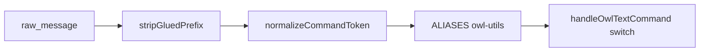

# Parser & Normalizer Hardening Spec (OwlHunt)

**Amaç:** klasik bot’dan gelen oyuncu alışkanlıklarını (kısa prefix, yapışık alias) OwlHunt komutlarına **kopyalamadan** çözümlemek.

## Pipeline



## Katmanlar

### 1. `stripGluedPrefix(content, guildPrefix)`

- Sadece `guildPrefix.length <= 3` için aktif (ör. `w`, `owl`).
- `wh` + prefix `w` → `h` (tek harf rest).
- `wcf` + prefix `w` → `cf` (glued regex match).
- Uygulama: [`src/utils/legacy-command.ts`](../src/utils/legacy-command.ts), çağrı: [`src/index.ts`](../src/index.ts).

### 2. `normalizeCommandToken(raw)` — klasik bot → OwlHunt intent

Kaynak tablo: [`src/data/command-insights.json`](../src/data/command-insights.json) → `legacyToOwlAliases`.

| klasik bot girdi | OwlHunt intent | Not |
|-----------|----------------|-----|
| h, wh, hunt | hunt | |
| b, wb, battle | duel | klasik bot battle ≠ OwlHunt `vs`; PvE duel |
| s, ws, sell | sell | |
| cf, wcf | cf | PvP coinflip |
| bj, wbj | bj | |
| wslots, wsl, slot | slot | |
| daily, wdaily, wd, wq | quests | klasik bot daily → OwlHunt görevler |
| cash, wcash, c, money | cash | |
| pray, wp | buffs | |
| z, wz, zoo | zoo | |
| inv, wi, inventory | inventory | |
| top, lb, leaderboard | lb | |

**Kopyalanmayan klasik bot komutları:** sacrifice, autohunt, huntbot, lottery, marry, meme komutları — bilinçli olarak desteklenmez; unknown + migration hint.

### 3. `ALIASES` — OwlHunt iç alias

[`src/commands/owl-utils.ts`](../src/commands/owl-utils.ts) — Türkçe ve kısa formlar (`yardım`, `ver`, `aç`, `sk`).

Çözüm sırası (`handleOwlTextCommand`):

```typescript
const rawSub = (parts[0] ?? '').toLowerCase();
const normalized = normalizeCommandToken(rawSub);
const sub = ALIASES[normalized] ?? ALIASES[rawSub] ?? normalized;
```

## Gürültü filtresi (ingest / telemetry)

MetaLab QC’de aşağıdakiler **komut sayılmaz**:

- `len(raw_message) > 400`
- İlk token `**` veya `<:` ile başlar
- İçerik `http://`, `https://`, `discord.gg/`
- `is_bot_response = 1` veya `author.bot`

## Test matrisi

Vitest: [`src/__tests__/legacy-parser.test.ts`](../src/__tests__/legacy-parser.test.ts)

| Girdi | prefix | Beklenen ilk token (strip sonrası) | normalize | ALIASES son |
|-------|--------|-------------------------------------|-------------|-------------|
| `wh` | w | h | hunt | hunt |
| `wb` | w | b | duel | duel |
| `wcf` | w | cf | cf | cf |
| `wbj` | w | bj | bj | bj |
| `wdaily` | w | daily | quests | quests |
| `wcash` | w | cash | cash | cash |
| `owl wcf` | owl | wcf | cf | cf |
| `w hunt` | w | hunt | hunt | hunt |

## Regression metrikleri

`scripts/metalab-qc.py` ile haftalık:

- `parseCoverageClean >= 92%`
- `unknownPctClean <= 8%`

## Gelecek iyileştirmeler (opsiyonel)

1. `CommandEvent`’e `normalizedIntent` yazımı.
2. Unknown komutta `findClosest` + `buildAliasMigrationHint` birleşik öneri.
3. MetaLab ingest’te bot mesajı filtreleme.
