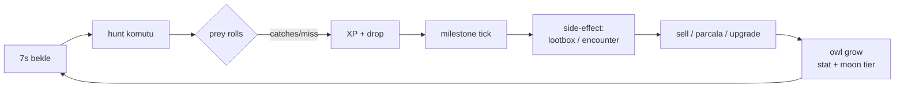
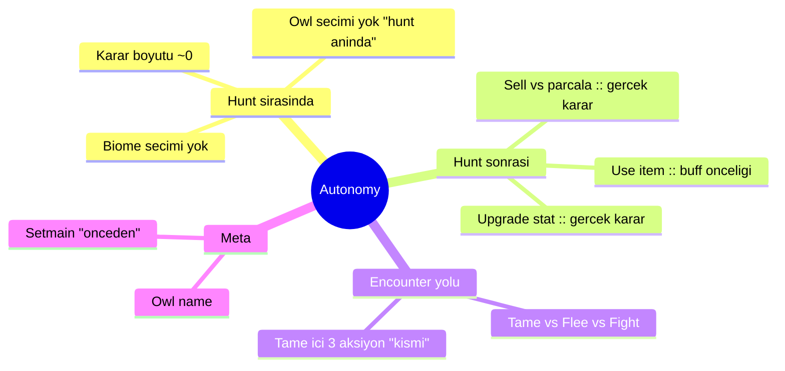

# CORE_LOOP — OwlHunt Oyuncu Deneyimi Zinciri

> Bu belge, [`PROJECT_ARCHITECTURE.md`](PROJECT_ARCHITECTURE.md)'nin oyuncu perspektifinden karşılığı: **bir hunt komutu yazılıp sonuç ekrana geldiğinde arka planda hangi loop döner, hangi ihtiyaç hangi yolla beslenir?**
>
> Amaç: yeni feature'lar için `Bu core loop'u güçlendiriyor mu?` sorusuna somut zeminde cevap verebilmek.
>
> Kaynak: kod (referanslı) + [`docs/research/owlhunt-core-design-audit.md`](../../research/owlhunt-core-design-audit.md).

---

## 1. Loop tanımı (kod tarafında)

Ana loop `/owl hunt` (`w hunt`, `w h`) etrafında döner. Toplam süre: **7 saniye cooldown**.

### 1.1 Kod ile eşleştirme

| Adım | Sahne | Kaynak dosya |
|------|-------|--------------|
| `[7s bekle]` | Cooldown enforcement | [`src/middleware/cooldown-manager.ts`](../../../src/middleware/cooldown-manager.ts), [`commands/owl-hunt.ts:enforceHuntCooldown`](../../../src/commands/owl-hunt.ts) |
| `[hunt komutu]` | Prefix + slash handler | [`commands/owl-hunt.ts:runHuntMessage`](../../../src/commands/owl-hunt.ts) |
| `prey rolls` | Roll sayısı + biome + owl stat | [`systems/hunt.ts:rollHunt`](../../../src/systems/hunt.ts) |
| `catches/miss` | Prey ağırlıklı seçim + baseChance + gizli modifier'lar | [`systems/hunt.ts:pickWeightedPrey`](../../../src/systems/hunt.ts), `catchChance` |
| `min guarantee` | Sıfır yakalama → düşük tier prey garanti | [`systems/hunt.ts:367-376`](../../../src/systems/hunt.ts) |
| `XP + drop` | XP hesabı + item drop + kritik | [`systems/hunt.ts:378-431`](../../../src/systems/hunt.ts) |
| `apply` | Redis Lua atomik | [`state/player-state.ts:applyHuntDelta`](../../../src/state/player-state.ts) |
| `milestone tick` | 25/50/80/… hedefleri | [`systems/hunt-milestones.ts:tickHuntMilestone`](../../../src/systems/hunt-milestones.ts) |
| `side-effect` | Lootbox + encounter (arka planda) | [`systems/hunt.ts:runHuntSideEffects`](../../../src/systems/hunt.ts) |
| `sell / parcala` | Prey → coin / materyal | [`commands/owl-misc.ts`](../../../src/commands/owl-misc.ts) + [`systems/items.ts`](../../../src/systems/items.ts) |
| `upgrade` | Stat maliyeti + garanti +1 | [`systems/upgrade.ts`](../../../src/systems/upgrade.ts) |
| `owl grow` | stat toplam → moon tier | [`systems/owl-moon-evolution.ts`](../../../src/systems/owl-moon-evolution.ts) |
| `quest fire` | Görevleri tetikle | [`systems/quest-tracker.ts`](../../../src/systems/quest-tracker.ts) → `daily-quests.ts` |

## 2. Loop’un “karar boyutu”

Audit'in en sert tespiti: **loop'un karar boyutu sıfıra yakın** (bkz. [`owlhunt-core-design-audit.md §1 Hidden Problem`](../../research/owlhunt-core-design-audit.md)).

Kod tarafında bunun kesin bir doğrulaması var:

| Karar noktası | Oyuncu seçebilir mi? | Kaynak |
|---------------|----------------------|--------|
| Biome | Hayır (b0 sabit, `DEFAULT_HUNT_BIOME_ID`) | [`config.ts` — BIOMES](../../../src/config.ts), `owl-hunt.ts` |
| Owl (main) | Ancak `setmain` ile önceden | [`commands/owl-misc.ts`](../../../src/commands/owl-misc.ts) |
| Trait build | Hayır (rastgele tame anında) | [`systems/traits.ts:rollTraits`](../../../src/systems/traits.ts) |
| Level-up | Hayır (otomatik ödül, seçim yok) | `buildLevelUpRewards` |
| Moon tier | Hayır (otomatik, stat sum'a bağlı) | [`systems/owl-moon-evolution.ts`](../../../src/systems/owl-moon-evolution.ts) |
| Item kullan | Evet (`w use <id>`) — buff seçimi | [`commands/owl-use.ts`](../../../src/commands/owl-use.ts) |
| Tame aksiyonu | Evet (3 buton: silent/distract/advance) | [`utils/tame-ux.ts`](../../../src/utils/tame-ux.ts) |
| Encounter aksiyonu | Evet (tame/flee/fight) | [`utils/encounter-ux.ts`](../../../src/utils/encounter-ux.ts) |
| Quest seçimi | Hayır (hash ile deterministik atama) | [`systems/daily-quests.ts:pickDailyQuestTypes`](../../../src/systems/daily-quests.ts) |
| Upgrade stat | **Evet** — hangi stat'ı ne kadar | [`systems/upgrade.ts`](../../../src/systems/upgrade.ts) |
| Sell/parçala tercih | **Evet** — coin mi materyal mi | Handler |

**Sonuç:** karar boyutu **tame + encounter + upgrade + item + sell tercihi**nde var — ancak **hunt anında** değil, **hunt sonrasında**. Loop içindeki 7 saniyelik pencere kararsız.

### 2.1 “Autonomy erişilebilir mi?” haritası

**Fikir:** Hunt-anı karar sıfırdan 1'e çekilirse (küçük bir stance/mod seçimi, veya biome erişimi) autonomy eksenine gerçek katkı olur. B4 tame prey-family + B2 biome + C4 skill tree buraya ilişkin.

## 3. Loop'un SDT ihtiyaç haritası

[`player-engagement-motivation-review.md §2.3`](../../research/player-engagement-motivation-review.md)'te tanımlı SDT ihtiyaçları core loop'un hangi adımında beslenir:

| İhtiyaç | Beslendiği yer(ler) | Zayıf yer(ler) |
|---------|---------------------|----------------|
| **Competence** | Hunt sonucu (XP + prey), level-up, moon tier, upgrade adımı, milestone patlaması | Gizli pity/streak/softcap → sinyal iletilmiyor (Audit §3 What Doesn't) |
| **Autonomy** | Sell/parçala, upgrade stat, item kullanımı, tame aksiyonu | Hunt anı (biome/owl/trait/tactic seçimi yok) |
| **Relatedness** | Trade (P2P escrow), market, social-hunt bonus (aynı kanaldaki oyuncular), guild var ama sığ | Guild kolektif hedef yok, mentor sistemi yok, kudos yok |

### 3.1 “Ödül türü × ihtiyaç” matrisi

| Ödül | Kaynak | Competence | Autonomy | Relatedness | Not |
|------|--------|:----------:|:--------:|:-----------:|-----|
| XP / level | Hunt, quest, milestone, encounter | ✔ | — | — | Görünürlük iyi |
| Coin | Sell, daily, pvp win | ✔ | ✔ | — | Autonomy: harcama seçimi |
| Prey (item) | Hunt | ✔ | ✔ | — | Sell/parçala tercihi |
| Lootbox | Hunt / PvP / encounter | ✔ | — | — | Anticipation motoru (Schultz RPE) |
| Rare drop (trait, high-tier prey) | Hunt (pity ile) | ✔ (ama gizli) | — | — | **DDR-003 aday** — görünürlük gerek |
| Trait | Tame | ✔ | — | — | Rastgele — B4 karar önerisi |
| Milestone reward | Silent-reset milestone | ✔ | — | — | En sağlıklı ödül kanalı |
| Daily reward | Daily login | ✔ (zayıf) | — | — | Extrinsic; I1 dilinde yumuşat |
| Retention bonus | Churn-safe modifier | — | ✘ (gizli) | — | Autonomy zıddı; **DDR-002 tartışması** |
| PvP kazanç | vs / duel / duelbet | ✔ | ✔ | ✔ | Sosyal boyut var |
| Trade tatmini | P2P trade | — | ✔ | ✔ | Escrow güvenli, sosyal katman |

## 4. Zaman ölçeğinde loop katmanları

```mermaid
gantt
    dateFormat  X
    axisFormat  %s
    section Micro (7s)
    Hunt komutu     :a1, 0, 7
    section Session (30–60 dk)
    Combo streak :a2, 0, 3600
    Session hunt streak (yok — B3 öneri) :crit, 0, 3600
    section Daily
    Login streak :a3, 0, 86400
    Daily quests (4) :a4, 0, 86400
    Milestone tick TTL :a5, 0, 86400
    section Weekly/Monthly
    Hunt milestone big claim :a6, 0, 604800
    LiveOps event pencereleri :a7, 0, 604800
    section Long-term
    Owl moon tier :a8, 0, 2592000
    Endgame boslugu (prestige yok, C3 tartisma) :crit, 0, 5184000
```

- **Micro (7 sn):** dopamin dalgası, kritik/rare/lootbox anticipation.
- **Session:** combo streak (`huntComboStreak`) 3/5 eşikleri XP komboya, ama **süre bazlı flow bonusu yok** → B3 önerisi.
- **Daily:** üç extrinsic katman paralel (login/quest/milestone) — audit'in “üç ayrı checklist” uyarısı (§6 What Doesn't).
- **Weekly:** yok — E1 (weekly-quests) belgede öneri, kod yok.
- **Long-term:** moon tier + species tier (1–8) grid + prey-dex. Prestige **kaldırılmış** ([`commands/owl-prestige.ts`](../../../src/commands/owl-prestige.ts) hala mevcut ama pasif — DDR-005 kapsamı dışı, C3 endgame tartışması ayrı).

## 5. “Player-in-the-moment” akışı — bir günlük tipik

Deneyimli bir oyuncunun bir günlük tipik oturumu (kaynak: kod + audit ölçek notu):

1. **Login:** `w daily` → 200–800 coin + kutu (bugün 30h/24h grace).
2. **İlk hunt:** `w hunt` → sonuç + milestone progress. İlk 5 hunt'ta “onboarding” yükü var (`w sell all` ipucu).
3. **Sell loop:** `w sl all` veya `w parçala all` → coin/materyal.
4. **Upgrade:** `w up gaga 10` → görünür stat büyümesi.
5. **Quest check:** `w q` → 4 quest, biri hazır olabilir.
6. **Encounter dalgası:** hunt'ın 8-10%'unda spawn — tame denemesi (3 tur) veya fight.
7. **Ara PvP:** `w vs @kullanıcı` — sosyal.
8. **Gamble aralarında:** `w cf`, `w slot` — coin sink (negatif EV).
9. **Milestone patlaması:** her 25/50/80… hunt'ta XP + kutu (silent-reset → araya boşluk sorun değil).
10. **Loop tekrarı — 7s cooldown.**

**Kırılma noktaları:**
- Cooldown mesajları hızlı komut yazan oyuncuyu rahatsız edebilir (yumuşatıldı — auto-delete + suppression).
- Sıfır yakalamalı hunt "boşa gitti" hissi verir → min guarantee tampon ama audit'in "anticipation düz" uyarısı burada.
- Gamble kayıp serisi → retention nudge otomatik devreye giriyor (**oyuncu bilmiyor** — DDR-002).

## 6. “Bot çözüldüğünde ne kalır?” haritası

Audit §7.3 senaryosu koda karşı doğrulanmış:

| Bacak | Kaynak | Çözüldüğünde |
|-------|--------|--------------|
| Hunt anticipation | `rollHunt` VR yapısı | Formül empirik çözülür, düzleşir |
| Rarity dopamin | `drops.ts` + pity | Şeffafsız → algılanan adalet erozyonu |
| Meta-goal scaffold | login+quest+milestone | Ekstrensik yorgunluk |
| Trade + relatedness | `systems/trade.ts` + market | En dayanıklı — sosyal katman |
| Moon tier grid | 1–8 species × moon | Sonlu grid, sonunda tükenir |
| Endgame (prestige) | **YOK** | Boşluk (C3 ayrı tartışma) |

**Sağlıklı taşıyıcı seçenekler (uzun vade):** trade/relatedness güçlendirme (G1 guild kolektif hedefi), gerçek autonomy (B4/C4), curiosity (K1 mystery) — bunların hiçbiri Wave 1 kapsamı değil ama roadmap'te işaretli.

## 7. Loop’a “dokunulmayacak” çekirdek

Audit §13 "kesin dokunulmasın" listesi kod tarafında karşılığıyla:

| Öğe | Neden | Kaynak |
|-----|-------|--------|
| 7 sn cooldown | Discord bağlamında ideal, flow için sağlıklı | [`HUNT_COOLDOWN_MS`](../../../src/config.ts) |
| Pity threshold=8 | Bad-luck koruması — kaldırılırsa güven yıkımı | [`HUNT_PITY_THRESHOLD`](../../../src/config.ts) |
| Streak bonus rate=+5% | Combo hissini besliyor | [`HUNT_STREAK_BONUS_RATE`](../../../src/config.ts) |
| Milestone silent-reset | Grace-friendly, Frommel & Mandryk 2022 uyumlu | [`HUNT_MILESTONE_INACTIVITY_SEC`](../../../src/config/hunt-milestones.ts) |
| Trade escrow + ready lock | Güvenlik + sosyal zemin | [`systems/trade.ts`](../../../src/systems/trade.ts) |
| Coin-only gamble sınırı | Dark-pattern sınırının iç tarafı | [`systems/gamble/`](../../../src/systems/gamble/) |

Wave 1 hiçbir P0 iş bu listeye dokunmuyor.

## 8. Loop görünürlük eksikleri (P0 aday özet)

Kod gerçekliği ile Audit §S2/S3 örtüşmesi:

| Eksik | Kod tarafındaki eksiklik | Wave 1 önerisi |
|-------|--------------------------|----------------|
| Milestone yaklaşımı | `progressLabel` var ama vurgusuz | A2 (son 3'te highlight) |
| Cooldown mesajı içeriği | Sadece "X sn bekle" | A3 (tek satır faydalı ipucu) |
| Drop oranı bilgisi | Hiçbir yerde ilan edilmiyor | A4 (`/owl help drops`) |
| Pity sayacı | `noRareStreak` sadece internally | D2 (hunt sonucu satırı) |
| Level tier etiketi | Sadece sayı | A6 (5–8 tier) |
| Daily reward dili | "streak +1" | I1 (hediye dili) |
| Hata mesajları dili | Karışık | L4 (adalet + öğreticilik) |
| Welcome-back | Yok | A7 (7+ gün, tek seferlik) |

Bunların hepsi loop'u **güçlendirir**, hiçbiri **değiştirmez**.

## 9. Bu belgenin bağı

- [`PROJECT_ARCHITECTURE.md`](PROJECT_ARCHITECTURE.md) — teknik zemin
- [`FEATURE_MATRIX.md`](FEATURE_MATRIX.md) — her feature'ın loop üzerindeki etkisi
- [`IMPLEMENTATION_ROADMAP.md`](IMPLEMENTATION_ROADMAP.md) — dalgalara yerleşim
- [`../decisions/DECISION-001-daily-maintenance-rework.md`](../decisions/DECISION-001-daily-maintenance-rework.md) — loop dışında bir "ceza" çakışması
- [`../decisions/DECISION-002-gambling-streak-modifier.md`](../decisions/DECISION-002-gambling-streak-modifier.md) — loop'un algılanan adalet zemini

**Belge sonu.**
