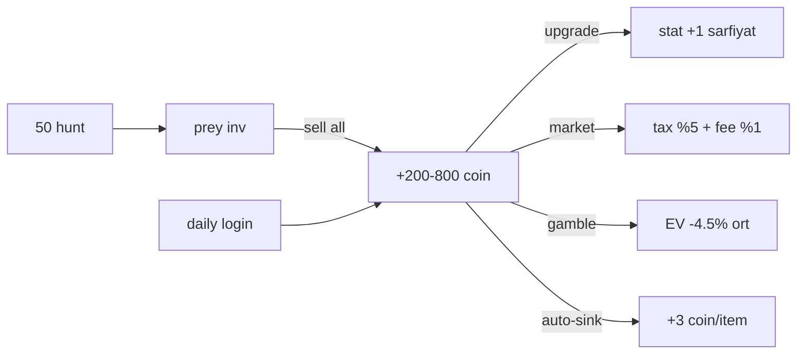

# ECONOMY_IMPACT — Coin/XP Sink/Source Haritası ve Feature Etkileri

> Amaç: yeni özelliklerin ekonomik dengeye etkisini analiz için tek başvuru. Sink = coin/kaynak yok eden; Source = coin/kaynak üreten.
>
> Kaynak: [`src/config.ts`](../../../src/config.ts) sabitleri + `systems/*` sink/source çağrıları.

---

## 1. Mevcut kaynak haritası (Source)

| Kanal | Tipik değer | Kaynak | Not |
|-------|-------------|--------|-----|
| **Hunt → prey satış (sell)** | Prey difficulty'ye bağlı, `PREY[].sellPrice` | [`systems/hunt.ts`](../../../src/systems/hunt.ts) → sell komutu | Ana gelir |
| **Hunt → parçala** | Materyal (coin değil ama upgrade sink'i beslediği için source-yerine-source) | [`systems/hunt.ts`](../../../src/systems/hunt.ts) + `items.ts` | Coin akışı yaratmaz, coin sink'ini besler |
| **Hunt → lootbox** | Nadiren silah/eşya kutusu | [`systems/drops.ts`](../../../src/systems/drops.ts) | Buff, coin değil |
| **Daily login** | 200–800 coin/gün + kutu | [`DAILY_LOGIN_BASE_COIN=200`](../../../src/config.ts), growth=25, cap=800 | Streak bazlı büyüyor; audit'in "undermining" uyarısı |
| **Milestone reward** | Kutu + XP (dolaylı coin) | [`hunt-milestones.ts`](../../../src/systems/hunt-milestones.ts) | Silent-reset ile korunmuş |
| **PvP (SIM/vs) kazanç** | `SIM_PVP_WIN_COINS=130` (bot duel), gerçek PvP daha düşük | [`config.ts:1188`](../../../src/config.ts) | `DUEL_DAILY_COIN_CAP=2_200` |
| **Auto-sink** (fazla item) | `AUTO_SINK_COIN_PER_ITEM=3` + 1 XP | [`systems/economy.ts:autoSink`](../../../src/systems/economy.ts) | Envanter dolduğunda otomatik |
| **LiveOps event XP** | `huntBonusRate` çarpanı | [`systems/liveops-cadence.ts`](../../../src/systems/liveops-cadence.ts) | Weekend/festival |
| **Encounter fight** | Prey difficulty bazlı ödül | [`systems/encounter-fight.ts`](../../../src/systems/encounter-fight.ts) | Nadir |
| **Rebalance compensation** | Balance değişikliğinde telafi | [`rebalance-compensation.ts`](../../../src/systems/rebalance-compensation.ts) | Süreç |

## 2. Mevcut sink haritası

| Kanal | Oran / miktar | Kaynak | Not |
|-------|--------------|--------|-----|
| **Upgrade maliyeti** | `UPGRADE_COST` tablosu, stat başına artan materyal + coin | [`config.ts:327`](../../../src/config.ts), [`systems/upgrade.ts`](../../../src/systems/upgrade.ts) | Ana sink |
| **Market tax** | `MARKET_TAX_RATE=5%` (satıştan kesinti) | [`config.ts:1550`](../../../src/config.ts) | Ekonomiye geri dönmez |
| **Market listing fee** | `MARKET_LISTING_FEE_RATE=1%` (iade yok) | [`config.ts:1551`](../../../src/config.ts) | İptal edilse bile ücret gider |
| **Biome entry cost** | `BIOMES[i].entryCost` (b0=0) | [`config.ts` BIOMES](../../../src/config.ts) | Şu an aktif değil (b0 tek) |
| **Gambling negatif EV** | Coinflip 95.55% RTP (`GAMBLE_COINFLIP_PAYOUT=1.95` × 0.49 chance); Slot ~45% RTP; BJ 99% | [`config.ts:730`](../../../src/config.ts) | En büyük coin sink |
| **Daily maintenance ceza** | Cig Et yoksa −5 effectiveness (kalıcı) | [`economy.ts:dailyMaintenance`](../../../src/systems/economy.ts) | **DDR-001 tartışma konusu — coin sink değil, item sink** |
| **Transfer fee** | Yok | [`systems/transfer.ts`](../../../src/systems/transfer.ts) | Not: transfer sink değil ekonomi-nötr |

## 3. Net coin akışı (yaklaşık, aktif oyuncu)

**Varsayım:** Oyuncu 2 saatlik oturumda ~50 hunt yapar (7 sn cooldown × sağlıklı oynama %25 gerçek kullanım), 3 quest tamamlar, 1 gamble seansı yapar.

- **Net günlük coin üretimi (tipik aktif oyuncu):** 3–8k coin brüt.
- **Ana sink kapasitesi:** Upgrade (level'e göre 500 → 10k+ maliyet), gambling (agresif oyuncuda saatlik binlerce coin), market fee (%6 toplam).
- **Ekonomi denge kırılganlığı:** Yüksek. Yeni bir cömert source katmanı (örn. büyük welcome-back paketi) enflasyon üretir; yeni sink (D3 kozmetik) enflasyona karşı ilaç.

## 4. Newbie boost etkisi

- **NEWBIE_BOOST_DAYS=7**, **NEWBIE_XP_MULTIPLIER=1.12**, **NEWBIE_LUCK_BONUS=0.02** ([`config.ts:1589`](../../../src/config.ts)).
- Newbie aktifken retention modifier **0** ([`retention-modifiers.ts:63-66`](../../../src/systems/retention/retention-modifiers.ts)) — çift bonus riski yok.
- Alt-account teşviki oluşturmaz — 7 gün'lük pencere kısa; ancak Wave 2 A7 (welcome-back pack) tasarımı 7+ gün gap için tetiklenmeli ve **newbie'ye rakip olmamalı**.

## 5. Değerlendirilen özelliklerin ekonomik etkisi

Aşağıdaki tablo Wave 1–5 arasındaki tüm IMPLEMENT/IWC kararlarının ekonomik etkisini özetliyor.

| Wave | Feature | Source etkisi | Sink etkisi | Farming yüzeyi | Not |
|------|---------|:-------------:|:-----------:|:--------------:|-----|
| 1 | A2 milestone yaklaşım | — | — | — | Sadece UI |
| 1 | A3 cooldown mesaj içerik | — | — | — | UI |
| 1 | A5 quest kotası doğrula | — | — | — | UI |
| 1 | A6 tier etiketi | — | — | — | UI |
| 1 | I1 daily reward dili | — | — | — | UI |
| 1 | L4 error dili | — | — | — | UI |
| 1 | I3 silent streak politikası yaz | — | — | — | UI (help) |
| 2 | A4 drop şeffaflığı | — | — | — | UI (help) |
| 2 | D2 pity satırı | — | — | — | UI (hunt sonuç) |
| 2 | A7 welcome-back pack | **+küçük** (7+ gün gap, ay içinde 1) | — | Düşük — ay içinde max 1 + newbie ile ortogonal | Kalibrasyon: audit "cömert değil, karşılayıcı" |
| 2 | O2 changelog süreci | — | — | — | Yazılı |
| 3 | E4 bugünkü hedef satırı | — | — | — | UI |
| 3 | F2 market fiyat sinyali | — | Dolaylı sink (bilgili alıcı, düşük abuse) | — | Ekonomiye iyi |
| 3 | M1 gamble stats | — | — | — | UI |
| 3 | P1/P3/P4 metrikler | — | — | — | Sadece ölçüm |
| 4 | B3 session hunt streak | +küçük (XP bonus) | — | Düşük — cezasız, session-bounded | Kalibrasyon: max +%10 |
| 4 | B5+K1 prey-dex mystery + progress | — | — | — | UI |
| 4 | C2 evrim görselleştir | — | — | — | UI |
| 4 | C5 milestone XP kalibrasyonu | ±küçük | — | — | Metrik sonrası |
| 4 | H4 newbie ceza-yok doğrulama | — | — | — | Kod'da zaten |
| 5 | DDR-001 maintenance rework | — | **Aynı sink (Cig Et harcanır)** ama pozitif frame | — | Ekonomik nötr |
| 5 | DDR-002 gambling streak modifier | **+küçük net** (kaybeden az kaybediyorsa) | Dolaylı: RTP açıklandığı için "bilinçli oyun" | — | Audit "streak modifier'ı kaldır" |

### 5.1 A7 welcome-back kalibrasyon önerisi

Ay içinde 1 kere, minimum gap 7 gün. Öneri:

| Gap süresi | Pack içeriği |
|-----------|-------------|
| 7–14 gün | 500 coin + 1 eşya kutusu |
| 15–30 gün | 1000 coin + 1 silah kutusu + 1 eşya kutusu |
| 30+ gün | 2000 coin + 2 kutu + belirsiz süreli bond bonusu |

Daily login `DAILY_LOGIN_BASE_COIN` (200) ve `DAILY_LOGIN_COIN_CAP` (800) ile karşılaştırıldığında **karşılayıcı** (2–5x günlük), **cömert değil**. Alt-account teşviki: gap süresi 7+ gün olduğundan farmer için verimsiz.

## 6. Reddedilen özelliklerin ekonomik gerekçesi

| Feature | Neden reddedildi | Ekonomik risk |
|---------|-----------------|---------------|
| X1 Gerçek para RNG loot box | Yasak (kural) | Kumar yasal + etik risk |
| X5 Alt-account teşvikli farming | Yasak | Multi-account exploit |
| X6 "Bilerek kazandır" kumar | Yasak | Autonomy + adalet yıkıcı |
| X10 Kozmetiği yalnızca pay-only | Yasak | Motivational needs kilitli |

## 7. Gelecek dalga ekonomik uyarıları

- **G1 Guild kolektif hedefi (Wave 6):** kolektif ödül tasarımında **guild başına havuz cap** olmadan enflasyona kayabilir; guild size × ödül eğrisi lineer kalmalı.
- **D3 Kozmetik reward (Wave 6+):** İyi sink (power creep'siz). Ancak **oyun-içi kazanılabilir** olmalı (kural X10). Pay-only olmasın.
- **C3 Prestige / endgame (Wave 6+):** Prestige "coin reset" mi, "meta-currency" mi olacak? Reset tasarımı total sinklerin sıfırlanmasına dikkat.
- **F2 Market fiyat sinyali (Wave 3):** Piyasa manipülasyonu riskini gözle (tek satıcı listeleyip sinyali bozması). Öneri: aggregate en az N satış olduğunda göster (N=5).

## 8. Bu belgenin bağı

- [`PROJECT_ARCHITECTURE.md §7`](PROJECT_ARCHITECTURE.md) — ekonomi hot spot özeti
- [`FEATURE_MATRIX.md`](FEATURE_MATRIX.md) — feature kararları
- [`../decisions/DECISION-001-daily-maintenance-rework.md`](../decisions/DECISION-001-daily-maintenance-rework.md) — item sink revizyonu
- [`../decisions/DECISION-002-gambling-streak-modifier.md`](../decisions/DECISION-002-gambling-streak-modifier.md) — gamble RTP şeffaflığı
- [`../../.cursor/rules/economy-safety.mdc`](../../../.cursor/rules/economy-safety.mdc) — kural özet (bu turda yazılıyor)

**Belge sonu.**
