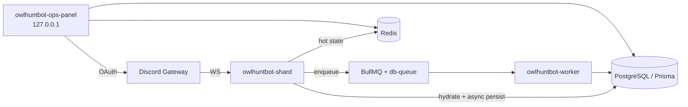
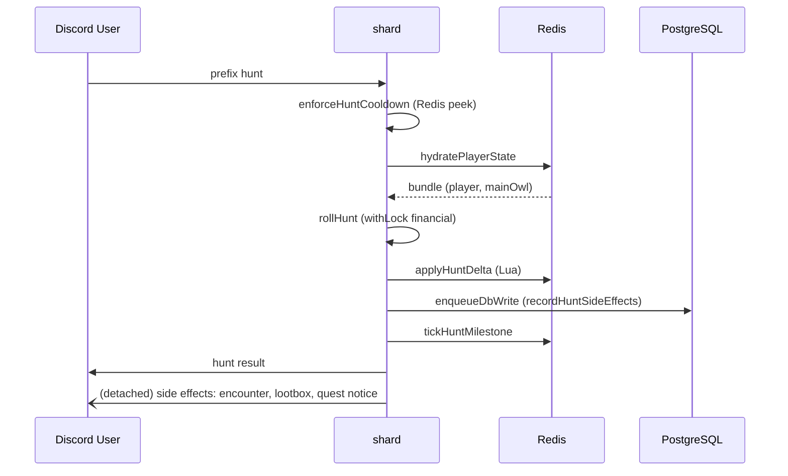
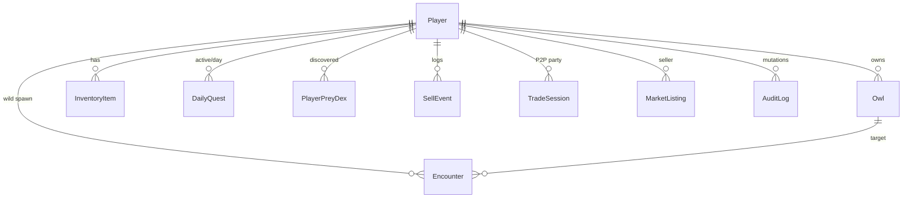

# PROJECT_ARCHITECTURE — OwlHunt Bot

> Bu belge memory-bank'ı **tekrarlamaz, derinleştirir.** Kısa harita için [`../memory-bank/architecture.md`](../memory-bank/architecture.md); AI kanunu için [`../AI_GUIDELINES.md`](../AI_GUIDELINES.md).
>
> Amaç: engagement-analysis dalgasına temel oluşturmak — mevcut mimarinin **hangi yerlerinin dokunulabilir, hangi yerlerinin donmuş** olduğunu net kayıt.
>
> Sürüm: 2026-09-14 · Analiz turu.

---

## 1. Süreç modeli ve fiziksel yerleşim



**Üç PM2 süreci** (kaynak: [`ecosystem.config.js`](../../../ecosystem.config.js), [`pm2-protection.mdc`](../../../.cursor/rules/pm2-protection.mdc)):

| İsim | Rol | Instance | Durum |
|------|-----|----------|-------|
| `owlhuntbot-shard` | Discord I/O + oyun komutları | ölçekli (shard) | online |
| `owlhuntbot-worker` | BullMQ tüketici + cron | **tek** (ADR-3) | online |
| `owlhuntbot-ops-panel` | Localhost HTTP + copy-editor + analytics | 1 | opsiyonel |

**Kritik kısıt:** worker tek instance varsayımı. Cron / persist / retention scan tekrarlanmaz. Bu varsayım kırılırsa çift persist / duplicate reward riski.

## 2. Veri akışı — hot path

`/owl hunt` → şu zincir (dosya:satır referansları):



- **Lock:** `withLock(playerId, 'financial')` — tek çekişme noktası. Coin/XP/inv mutasyonları hepsi bu kilit altında. Kaynak: [`src/utils/lock.ts`](../../../src/utils/lock.ts), örnek [`src/systems/hunt.ts:208`](../../../src/systems/hunt.ts).
- **Atomik ekonomi:** coin/XP delta Redis Lua ile uygulanır (`state/player-state.ts:applyHuntDelta`, `deductCoinsInRedis`). PG'ye yazım `db-queue` üzerinden async.
- **Hydration:** `hydratePlayerState` — Redis'te yoksa PG'den çek + Redis'e yaz; TTL yönetimi buradan.
- **Metrics:** `beginHuntHotPathMetrics` her hunt'ta ölçüm topluyor ([`src/utils/hunt-hotpath-metrics.ts`](../../../src/utils/hunt-hotpath-metrics.ts)).

**Yazma politikası (invariant #3):** Hot path'te doğrudan `prisma.*.update` **yasak**. Hydrate / admin ops / arka plan istisna. Yeni özellik hunt akışına yazma eklerken db-queue'ya enqueue etmeli, direkt PG'ye değil.

## 3. Veri akışı — cold path

- **db-queue** ([`src/utils/db-queue.ts`](../../../src/utils/db-queue.ts)): shard tarafında `enqueueDbWrite(...)` çağrısı, worker/persister süreç tüketir. Şu an tek in-process kuyruk (persist fırlatma "detached run").
- **BullMQ jobs** ([`src/jobs/background-jobs.ts`](../../../src/jobs/background-jobs.ts)): cron benzeri periyodik işler. Örnek: `dailyMaintenance` toplu batch (`batch.map((p) => dailyMaintenance(...))`), leaderboard rebuild, retention scan.
- **Prisma:** [`prisma/schema.prisma`](../../../prisma/schema.prisma). Migration: **sadece açık kullanıcı isteği** ([`database-protection.mdc`](../../../.cursor/rules/database-protection.mdc), [`production-safety.mdc`](../../../.cursor/rules/production-safety.mdc)).

## 4. Domain model (kısaltılmış)



- **Global profil (ADR-6):** Player kaydı Discord user id'e bağlı, guild'e değil. Bir kullanıcı bir ekonomi profili — tüm guild'lerde aynı.
- **Owl:** main owl (`isMain=true`) hunt/PvP/tame'de kullanılır. Diğer owl'lar pasif (`passiveMode`).
- **Redis "sıcak" kopyası:** `player-state.ts` bir `CachedPlayerData` bundle'ı tutar (`coins, xp, level, huntComboStreak, noRareStreak, gambleStreakWins/Losses, ...`). Bu bundle "gerçek" ekonomi kaynağıdır (hot path); PG asenkron takip eder.

## 5. Katman haritası

| Katman | Yol | Ne yapar | Dokunma politikası |
|--------|-----|----------|--------------------|
| Handler (I/O) | `src/commands/` (~10k satır) | Discord slash/prefix girişi | İnce tutulmalı; iş mantığı yok |
| Rules (business) | `src/systems/` (~15k) | Hunt/PvP/market/tame/quests/… | Yeni sistem: `<konu>.ts` (veya alt klasör) |
| State | `src/state/player-state.ts` + `state/lua/*.lua` | Redis-first hydrate/mutate | Coin/XP mutasyonu ancak buradan |
| UX helpers | `src/utils/` | Embed, safe-reply, screens, math, rng | Screen büyüdüğünde bölünecek |
| Config | `src/config.ts` + `src/config/*.ts` | Sabitler + copy catalog | **Logic yok**; sadece veri |
| Interactions | `src/interactions/` | Button/modal handler (market, anticheat) | Handler ince |
| Middleware | `src/middleware/` | Cooldown, load-shed, abuse | Pipeline |
| Anticheat | `src/anticheat/` | Rate, trust, captcha, punishment | Modüler, iyi örnek (400 satır altı) |
| Ops | `src/ops/` + `ops-panel.ts` | 127.0.0.1 HTTP + OAuth + copy editor | Localhost only |
| Jobs | `src/jobs/` + `src/worker.ts` | BullMQ + cron | Tek worker instance |
| Tests | `src/__tests__/` + iç `__tests__/` | Vitest | Davranış değişince eklenecek |

### 5.1 Bilinçli 800+ satır dosyalar (memory-bank onayı)

| Dosya | Satır | Rol | Bu turda büyütme? |
|-------|-------|-----|-------------------|
| [`src/config.ts`](../../../src/config.ts) | 1744 | Sayı kataloğu | Yeni sabit ekleyebilir; logic ekleme yok |
| `src/commands/admin.ts` | 800+ | Admin/ops | Genişletme yasak |
| `src/state/player-state.ts` | 800+ | Redis + Lua state | Genişletme yasak |
| `src/systems/market.ts`, `utils/market-screens.ts` | 800+ | Market | Genişletme yasak |
| `src/commands/pvp.ts`, `utils/pvp-ux.ts` | 800+ | PvP | Genişletme yasak |

Bu dosyalara Wave 1 hedefli **hiçbir P0** iş dokunmuyor.

## 6. Cross-cutting sistemler

Aşağıdakiler her komutu potansiyel olarak etkiler; yeni özellik yazarken kontrol edilmeli.

### 6.1 Anticheat pipeline

- [`src/anticheat/index.ts`](../../../src/anticheat/index.ts) — orkestre.
- `rate-limiter` (Redis token bucket), `trust-score`, `captcha-manager` (challenge), `market-anomaly`, `multi-account-heuristics`, `punishment-engine`, `reward-throttle`.
- **Reward throttle** ([`anticheat/reward-throttle.ts`](../../../src/anticheat/reward-throttle.ts)): `applyRewardMultiplier(prisma, {userId, guildId, rewardType}, amount)` — hunt/PvP XP kazançlarında uygulanır. Yeni ödül kanalı eklerken **bu API ile geçmesi zorunlu**.
- Kill-switch mevcut; ops guild üzerinden yönetilir.

### 6.2 Retention

- [`src/systems/retention/`](../../../src/systems/retention/):
  - `churn-score.ts` — `safe / at_risk / churning` bucket.
  - `player-activity.ts` — session-loss tracking, `consumeReturnBonusUse`.
  - `retention-modifiers.ts` — hunt/gamble/tame için `+0..+8%` gizli bonus + return extra.
  - `abtest.ts` — A/B bucket (`retentionBucketForUser`), `socialBonusMult`.
  - `metrics-baseline.ts` — D1/D7/D30 ölçüm iskeleti.
- **Retention nudge zaten "gizli" — DDR-002/003 kapsamında görünürlük veya sınırlama tartışılacak.**
- Newbie boost: [`systems/newbie-boost.ts`](../../../src/systems/newbie-boost.ts) — 7 gün, `NEWBIE_XP_MULTIPLIER=1.12`, `NEWBIE_LUCK_BONUS=0.02`. Newbie aktifken retention modifier **0** (kod). Bu iyi bir örtüşme.
- Reengagement: [`systems/reengagement.ts`](../../../src/systems/reengagement.ts) — 3+ gün inaktif oyuncular Redis kümesine alınır (400 batch, 24h TTL). Kullanıcıya iletim mekanizması **henüz yok** (Wave 6 aday).

### 6.3 LiveOps cadence

- [`src/systems/liveops-cadence.ts`](../../../src/systems/liveops-cadence.ts): saat/gün bazlı `huntBonusRate` (weekend, festival). Hunt handler bunu ekliyor:

```
221:225:src/commands/owl-hunt.ts
    const liveOps = currentLiveOpsModifier();
    const liveOpsXp = liveOps.huntBonusRate > 0 ? Math.round(result.totalXP * liveOps.huntBonusRate) : 0;
    if (liveOpsXp > 0) {
      await addXP(ctx.prisma, userId, liveOpsXp, 'liveOpsHunt', undefined, undefined, ctx.redis);
      huntText += `\n🎉 ${liveOps.label}: +${liveOpsXp} XP`;
    }
```

- **Bu kanal görünür** — dokunmadan alta çekilecek örnek.

### 6.4 Social retention

- [`systems/social-retention.ts`](../../../src/systems/social-retention.ts): `applySocialHuntBonuses` — kanaldaki diğer oyuncularla eş zamanlı hunt cezasız/bonuslu. Guild + channel scope.

### 6.5 Onboarding

- [`systems/onboarding.ts`](../../../src/systems/onboarding.ts) — `markFirstHuntComplete`, ilk hunt/inv/upgrade ipuçları.
- [`utils/newbie-hints.ts`](../../../src/utils/newbie-hints.ts) — hunt mesajına eklenen contextual ipuçları.

## 7. Ekonomi hot spot'ları (özet — detay `ECONOMY_IMPACT.md`)

| Kaynak (source) | Sink (giden) |
|-----------------|--------------|
| Hunt → prey sat | Market %5 tax + %1 listing fee |
| Milestone reward (lootbox, XP dolaylı coin) | Biome entry cost (b0 = 0) |
| Daily login coin (200–800, cap) | Upgrade maliyeti (stat başına artan) |
| PvP kazanç (SIM_PVP_WIN_COINS, cap) | Gambling negatif EV (coinflip 95.55% RTP, slot ~45% RTP, BJ ~99%) |
| Auto-sink (fazla item → 3 coin + 1 XP) | Daily maintenance (item harcaması — Cig Et) |
| LiveOps event bonusu | Trade (kullanıcı-arası, ekonomi neytr) |

## 8. Kod-agnostik güvenlik ve prod kısıtları

- [`production-safety.mdc`](../../../.cursor/rules/production-safety.mdc) — `rm -rf`, `mkfs`, `shutdown` vb. yasak; `/etc /usr /boot` dokunulmaz; prisma migrate onaysız çalıştırılmaz.
- [`docker-protection.mdc`](../../../.cursor/rules/docker-protection.mdc) — `docker compose down`, `docker rm`, `system prune` onay ister.
- [`pm2-protection.mdc`](../../../.cursor/rules/pm2-protection.mdc) — restart/reload/stop/delete/kill onay ister.
- [`database-protection.mdc`](../../../.cursor/rules/database-protection.mdc) — production DB'de `DELETE/TRUNCATE/DROP/ALTER` yasak (kullanıcı isteği hariç).
- [`git-snapshot.mdc`](../../../.cursor/rules/git-snapshot.mdc) — her implementation öncesi `git status` + snapshot commit.
- [`audit-mode.mdc`](../../../.cursor/rules/audit-mode.mdc) — analiz/audit/review istekleri için otomatik salt-okunur mod.
- [`auto-push-github.mdc`](../../../.cursor/rules/auto-push-github.mdc) — GitHub yedek opsiyonel; her değişiklikte push zorunlu değil.

## 9. Test iskeleti

- **Vitest** (v4), `pnpm test`. `vitest.config.mts` root.
- `src/__tests__/` (~100 dosya) + `src/systems/**/__tests__/` + yanında `*.test.ts`.
- Örnek "iyi test" kalıpları:
  - [`src/__tests__/hunt-milestones.test.ts`](../../../src/__tests__/hunt-milestones.test.ts) — parametrik + build-message.
  - `src/__tests__/gamble-*.test.ts` — RTP, escrow, validate-bet.
  - `src/__tests__/integration-s1.test.ts` — mock Redis + concurrent lock.
- Property tests: `fast-check` (perf-hardening-pbt, migration.property).
- **Kural:** davranış değişince Vitest zorunlu ([`AI_GUIDELINES.md §7`](../AI_GUIDELINES.md)). Editor testi kod testinin yerini almaz.

## 10. Ölçek (mevcut gerçeklik notu)

- ~55k satır non-test TypeScript, ~289 dosya.
- En büyük yığın: `utils/` + `systems/` + `commands/`.
- Hedef guild sayısı: [`CAPACITY_100_GUILDS.md`](../../CAPACITY_100_GUILDS.md) — pilot ölçek.
- Redis TTL bazlı sıcaklık: hot path'in Redis'te sürdürülebilmesi mem cap'e bağlı; TTL yönetimi `player-state` içinde.

## 11. Bu belgenin diğerleriyle bağı

| Belge | Bağı |
|-------|------|
| [`CORE_LOOP.md`](CORE_LOOP.md) | Bu mimarinin oyuncu perspektifinden karşılığı |
| [`FEATURE_MATRIX.md`](FEATURE_MATRIX.md) | Her feature bu katmanın hangi noktasına dokunur |
| [`DESIGN_CODE_CONFLICTS.md`](DESIGN_CODE_CONFLICTS.md) | Kod gerçekliği vs research belgeleri arasındaki delta |
| [`ECONOMY_IMPACT.md`](ECONOMY_IMPACT.md) | Ekonomi sink/source detayı |
| [`../memory-bank/architecture.md`](../memory-bank/architecture.md) | Kısa/canlı özet (bu belge derinlik) |

**Belge sonu.**
