# OwlHunt Premium Upgrade Plan

**Companion doc:** [site-audit.md](./site-audit.md) (Phases 1, 2, 5, 6, 7 + mascot system)  
**Principle:** Refinement, not redesign. Keep owl, dark theme, red/gold, `public/ops-panel/owlhuntweb/` assets.

---

# Phase 3 — Brand strengthening: 50+ naming ideas

*Proposals only — not implemented. Adapted for a Discord owl-hunting game (not AI product discovery). Themes: owl, hunt, biomes, rarity, signal vs noise, quality over hype.*

## Owl & instinct (12)

| # | TR | EN | Use case |
|---|----|----|----------|
| 1 | Gece Gözü | Night Eye | Brand line / season |
| 2 | Tüy İzi | Feather Trail | Activity feed |
| 3 | Sessiz Kanat | Silent Wing | Stealth hunt buff |
| 4 | Pençe Anı | Talon Moment | Critical hit label |
| 5 | İz Sürücü | Trail Hunter | Player title |
| 6 | Baykuş Refleksi | Owl Reflex | Quick-time tame |
| 7 | Av İçgüdüsü | Hunt Instinct | Streak mechanic name |
| 8 | Yukarı Bak | Look Up | Easter egg / hint |
| 9 | Hu! Anı | Hu! Moment | Rare drop celebration |
| 10 | Göz Kırpması | Blink | Short cooldown flavor |
| 11 | Çift Göz | Twin Gaze | PvP intro |
| 12 | Ötüş Saati | Hoot Hour | Daily peak event |

## Hunt & biome (12)

| # | TR | EN | Use case |
|---|----|----|----------|
| 13 | Gece Avı | Night Hunt | Default mode label |
| 14 | Biyom Seçimi | Biome Pick | Session start |
| 15 | Derin İz | Deep Track | Forest biome tagline |
| 16 | Göl Sessizliği | Lake Silence | Lake biome tagline |
| 17 | Kasaba Turu | Town Round | Starter biome |
| 18 | Av Günlüğü | Hunt Log | Personal history (future web) |
| 19 | İlk İz | First Track | Onboarding step |
| 20 | Kritik Av | Critical Hunt | Existing — keep |
| 21 | Son Av | Last Hunt | Session summary |
| 22 | Av Serisi | Hunt Series | Combo/streak UI |
| 23 | Bölge Kilidi | Region Lock | 30-min session copy |
| 24 | Av Rotası | Hunt Route | Weekly challenge |

## Rarity & collection (12)

| # | TR | EN | Use case |
|---|----|----|----------|
| 25 | Nadir Avlar | Rare Catches | Collection tab |
| 26 | Gizli Tüy | Hidden Feather | Secret drop |
| 27 | Altın Tüy | Golden Feather | Top-tier quality |
| 28 | Koleksiyon Defteri | Collection Book | `/owl zoo` rename idea |
| 29 | Vitrin | Showcase | Profile display |
| 30 | Av Trofesi | Hunt Trophy | Achievement |
| 31 | Nadir An | Rare Moment | Confetti trigger label |
| 32 | İzole Bulgu | Isolated Find | Single rare in hunt |
| 33 | Çift Nadir | Double Rare | Back-to-back rares |
| 34 | Kalite Damgası | Quality Stamp | God Roll → TR label |
| 35 | Tüy Koleksiyonu | Feather Collection | Zoo alt title |
| 36 | Sinyal Avı | Signal Hunt | “Quality over noise” section |

## Leaderboard & prestige (10)

| # | TR | EN | Use case |
|---|----|----|----------|
| 37 | Sürü Lideri | Flock Leader | #1 rank title |
| 38 | Zirve Tüyü | Summit Feather | Top 3 badge |
| 39 | Prestij Yolu | Prestige Path | Ascension |
| 40 | Sezon Avı | Season Hunt | Season ID label |
| 41 | Güç Sırası | Power Rank | `/lb` power (existing) |
| 42 | Av Ustası | Hunt Master | `/lb` hunt (existing) |
| 43 | Arena Tacı | Arena Crown | PvP board |
| 44 | Servet İzi | Wealth Trail | Coins board |
| 45 | Haftanın Avı | Hunt of the Week | Featured player |
| 46 | Küresel İz | Global Trail | Global scope footer |

## Curated / quality-over-hype (8)

| # | TR | EN | Use case |
|---|----|----|----------|
| 47 | Baykuş Seçkisi | Owl Picks | Curated builds/items |
| 48 | Keskin Seçim | Sharp Pick | Editor’s choice |
| 49 | Gürültü Yok | No Noise | Anti-spam mod message |
| 50 | Sadece İz | Tracks Only | Minimal UI mode name |
| 51 | Onaylı Av | Approved Hunt | Mod-verified event |
| 52 | Haftanın İzleri | Tracks This Week | Recap newsletter |
| 53 | Gizli Hazîne | Hidden Hoard | Rare shop rotation |
| 54 | Taze Av | Fresh Hunt | New player buff |

## Section labels for website (6)

| # | TR | EN | Replaces |
|---|----|----|----------|
| 55 | Nasıl Avlanır | How to Hunt | Özellikler |
| 56 | Komutlar | Commands | Hızlı başlangıç (keep) |
| 57 | Sıralama & Prestij | Ranks & Prestige | Boss section split |
| 58 | Sunucu Kontrolü | Server Control | Admin `/owlonly` |
| 59 | Koleksiyon & Evcil | Collection & Tame | Feature C |
| 60 | Topluluk | Community | Support/Discord block |

---

# Phase 4 — Copywriting rewrite

**Voice:** Confident, human, direct, technical. No buzzwords. Match in-game pipe style where noted.

---

## Hero headlines (pick one)

### Turkish

| Variant | Headline | Subhead |
|---------|----------|---------|
| A | **Discord’da avlan. Koleksiyon kur.** | Biyom seç, nadir baykuş yakala, `/lb` ile yüksel. Slash ve prefix — Türkçe. |
| B | **Gece avı burada başlar.** | Sunucuna ekle, `owl hunt` yaz, ilk drop’unu gör. |
| C | **Gürültü değil — av.** | Yüzlerce kombinasyon, gerçek streak, gerçek sıralama. Bot değil, oyun. |
| D | **Baykuşların avı, senin sunucun.** | Evcilleştir, boss ile savaş, markette güçlen. |
| E | **Hu!** *(keep brand)* **Şimdi av zamanı.** | OwlHunt — Türkçe Discord av botu. Komutlar hazır, bekletmiyoruz. |

**Recommended:** A or C for clarity; E only if pun is non-negotiable brand equity.

### English

| Variant | Headline | Subhead |
|---------|----------|---------|
| A | **Hunt on Discord. Build your flock.** | Pick a biome, catch rare owls, climb `/lb`. Slash and prefix — Turkish-first. |
| B | **Night hunt starts here.** | Add to your server, type `owl hunt`, see your first drop. |
| C | **Not noise — a hunt.** | Real streaks, real ranks. A game loop, not a gimmick bot. |
| D | **Your server. Their hunt.** | Tame, fight bosses, trade on the market. |
| E | **Hu!** **Time to hunt.** | OwlHunt — Turkish Discord hunting bot. Commands ready. |

---

## Eyebrow

| TR | EN |
|----|-----|
| Discord av botu · Türkçe | Discord hunt bot · Turkish |
| Gece avı · Slash & prefix | Night hunt · Slash & prefix |
| thetuncay.com · OwlHunt | thetuncay.com · OwlHunt |

---

## CTA text

| Context | TR (primary) | TR (secondary) | EN (primary) | EN (secondary) |
|---------|--------------|----------------|--------------|----------------|
| Hero | Sunucuya Ekle | Discord ile Giriş | Add to Server | Sign in with Discord |
| Nav | Sunucuya Ekle | Giriş Yap | Add to Server | Log in |
| CTA band | İlk avını at | Profilini gör | Start your first hunt | View profile |
| Login | Discord ile Giriş Yap | ← Ana sayfa | Continue with Discord | ← Home |
| Dashboard empty | Botu sunucuna ekle | Nasıl başlarım? | Add bot to server | How to start |
| Invite flow | Giriş yap, sonra ekle | — | Sign in to invite | — |

---

## Section titles

| Section | TR options | EN options |
|---------|------------|------------|
| Features | Nasıl Avlanır / Av döngüsü / Oyunda ne var | How Hunting Works / The hunt loop |
| Hunt | Nadir avlar & biyomlar / Av ve drop | Rare hunts & biomes |
| Boss | Boss & sıralama / Encounter & `/lb` | Boss fights & ranks |
| Tame | Evcilleştir & kontrol / Tame mini-oyunu | Taming & server control |
| Commands | Hızlı başlangıç / Komutlar | Quick start / Commands |
| CTA | İlk avını at / Hazırsan tek adım | First hunt / One step left |
| Admin | Sunucu izleme / Ops (internal) | Server monitoring |

---

## Feature body copy (TR)

### Hunt (replaces “Yüzlerce av…”)

> `owl hunt` ile biyomunu seç. 30 dakika o bölgede kalırsın — drop ve şans o biyoma göre değişir. Kritik avda ek loot, nadirde confetti. Koleksiyonun Discord’da büyür.

### Boss & rank

> Yabani baykuşlar encounter olarak çıkar: savaş veya evcilleştir. PvP’de streak kır, coin kazan. Küresel sıralama için `/lb` — güç, av, nadir, arena, servet.

### Tame & admin

> Tame mini-oyunu bağ kurar; zoo’da koleksiyonunu görürsün. Sunucu sahipleri `/owlonly` ile botu tek kanala kilitleyebilir.

---

## Feature body copy (EN)

### Hunt

> Run `owl hunt`, lock a biome for 30 minutes, and hunt for drops tuned to that region. Crits mean extra loot; rares hit harder. Your collection lives in Discord.

### Boss & rank

> Wild owls spawn as encounters — fight or tame. PvP breaks streaks and fills your wallet. Global boards: `/lb` for power, hunts, rares, arena, wealth.

### Tame & admin

> The tame mini-game builds bond; `zoo` shows your collection. Admins use `/owlonly` to restrict bot commands to one channel.

---

## Product discovery copy (landing — what to play first)

**TR:**  
İlk 60 saniye: Sunucuya ekle → herhangi bir kanalda `owl hunt` → biyom seç → sonucu oku. Sonra `owl zoo` ve `/lb`.

**EN:**  
First 60 seconds: Add to server → `owl hunt` in any channel → pick biome → read your result. Then `owl zoo` and `/lb`.

---

## Leaderboard copy (Discord + future web)

**TR embed footer:**  
`Küresel · Sezon {id} · ~30 dk önbellek`

**TR empty:**  
`Henüz veri yok. İlk avını at — liste seni bekliyor.`

**TR rank-up (when wired):**  
`Av Ustası sıralamasında #{old} → #{new} (+{delta})`

**EN footer:**  
`Global · Season {id} · ~30 min cache`

**EN empty:**  
`No ranks yet. Run your first hunt.`

---

## Dashboard & profile copy

| State | TR | EN |
|-------|----|----|
| Loading | Profilin yükleniyor… | Loading profile… |
| Linked badge | Discord bağlı | Discord linked |
| Empty title | Henüz oyunda değilsin | Not in-game yet |
| Empty body | Sunucunda botu kullan, kullanım şartlarını onayla, sonra `owl hunt` at. Bu sayfa yenilendiğinde istatistiklerin görünür. | Use the bot in a server, accept terms, then run `owl hunt`. Refresh this page. |
| Main owl | Ana baykuş | Main owl |
| Stat labels | Seviye, Coin, XP, Güç, Toplam av, Nadir bulgu, PvP galibiyet, Av serisi | Level, Coins, XP, Power, Total hunts, Rare finds, PvP wins, Hunt streak |

---

## Empty & loading states (with mascot)

| State | Mascot | TR | EN |
|-------|--------|----|----|
| Loading | `12_loading` | Yükleniyor… | Loading… |
| Empty dashboard | `04_sleeping` | Henüz av yok. Uyuşma — sunucunda ilk avını at. | No hunts yet. Wake up — run your first hunt. |
| Empty ops guilds | `04_sleeping` | Bot henüz sunucuda değil. | Bot not in any server yet. |
| Error | `03_angry` | Bir şey ters gitti. Tekrar dene. | Something went wrong. Try again. |
| Success | `02_happy` | Tamam! | Done! |
| Rare teaser | `06_surprised` | Nadir av mümkün. | Rare drops possible. |
| Permission | `08_protector` | Bu kanalda komut kapalı. | Commands disabled in this channel. |
| Premium CTA | `09_premium` | Sıralamada yüksel. | Climb the ranks. |

---

## Login & trust microcopy

**TR:**  
Discord ile bağlan. Sadece kimliğin ve avatarın kullanılır; şifre saklanmaz. Botu eklemek için giriş zorunlu.

**EN:**  
Connect with Discord. We only use your ID and avatar; no password stored. Login required to add the bot.

---

## Ops panel (admin) copy

**Title TR:** OwlHunt Ops · Sunucu & sistem  
**Title EN:** OwlHunt Ops · Servers & system  
**Header mascot:** `07_developer.png`  
**Empty TR:** Shard hazır değil veya bot sunucuda yok.

---

# Phase 8 — Implementation plan (prioritized)

Each item: **Impact** (H/M/L), **Difficulty** (H/M/L), **Reasoning**, **Expected outcome**.

---

## P1 — Critical (do first)

### P1.1 Fix command names on landing

| | |
|--|--|
| **Impact** | H |
| **Difficulty** | L |
| **Reasoning** | `/owl shop` and `/owl profile` don’t exist; instant trust loss. |
| **Outcome** | Visitors copy working commands (`/owl market`, `/owl stats`). |
| **Files** | `public/site/index.html` |

### P1.2 Hero rewrite + product-first visual

| | |
|--|--|
| **Impact** | H |
| **Difficulty** | M |
| **Reasoning** | Pun headline + mascot-only hero = template bot site. |
| **Outcome** | 3–5 sec comprehension; hunt loop clear before scroll. |
| **Files** | `public/site/index.html`, `styles.css`; optional hunt mock HTML block |

### P1.3 Reskin ops-panel to brand tokens + `07_developer` mascot

| | |
|--|--|
| **Impact** | H |
| **Difficulty** | M |
| **Reasoning** | Indigo panel is a different product; breaks operator trust in brand. |
| **Outcome** | One visual system from landing → admin. |
| **Files** | `public/ops-panel/styles.css`, `index.html` |

### P1.4 Unify Discord embed colors to red/gold

| | |
|--|--|
| **Impact** | H |
| **Difficulty** | M |
| **Reasoning** | Blurple `0x5865F2` = generic Discord bot; players live in embeds more than web. |
| **Outcome** | In-game feel matches site; recognizable OwlHunt in every channel. |
| **Files** | `src/utils/theme.ts`, audit hardcoded hex in `*-ux.ts` |
| **Mapping** | PRIMARY → `#9b1c1c`, RARE → `#f5c518`, SUCCESS → dark green or gold-tint, DANGER → `#dc2626` |

### P1.5 Turkish consistency + lootbox English removal

| | |
|--|--|
| **Impact** | M |
| **Difficulty** | L |
| **Reasoning** | `bulunamadi`, `hos geldin`, “opens a box” break premium polish. |
| **Outcome** | Single language immersion in TR server. |
| **Files** | `src/commands/owl-misc.ts`, `onboarding.ts`, `stats-ux.ts`, grep `bulunamadi` |

### P1.6 Remove public Ops link from footer

| | |
|--|--|
| **Impact** | M |
| **Difficulty** | L |
| **Reasoning** | Exposes admin surface; looks unfinished. |
| **Outcome** | Cleaner public trust surface. |
| **Files** | `public/site/index.html` |

### P1.7 Deploy functional mascot on empty/loading

| | |
|--|--|
| **Impact** | M |
| **Difficulty** | L |
| **Reasoning** | Assets exist; unused `12_loading`, `04_sleeping`. |
| **Outcome** | States feel designed, not default. |
| **Files** | `dashboard.html`, `dashboard.js`, `login.html`, `ops-panel/index.html` |

---

## P2 — Important

### P2.1 Reorder sections: commands before features

| | |
|--|--|
| **Impact** | M |
| **Difficulty** | L |
| **Reasoning** | Product-first = commands are the product entry. |
| **Outcome** | Faster path to first action. |
| **Files** | `index.html` |

### P2.2 Reduce hero height; soften shot-frame styling

| | |
|--|--|
| **Impact** | M |
| **Difficulty** | L |
| **Reasoning** | 75vh + rotate + 3px border = template + cheap. |
| **Outcome** | More content above fold; calmer premium frame. |
| **Files** | `styles.css` |

### P2.3 CTA band upgrade (`09_premium`, dual CTA)

| | |
|--|--|
| **Impact** | M |
| **Difficulty** | L |
| **Reasoning** | Weak closing; missed login funnel. |
| **Outcome** | Higher dashboard signups + invites. |
| **Files** | `index.html` |

### P2.4 Dashboard hierarchy + empty state steps

| | |
|--|--|
| **Impact** | M |
| **Difficulty** | M |
| **Reasoning** | Web profile is retention surface after invite. |
| **Outcome** | Returning users see value or clear next step. |
| **Files** | `dashboard.html`, `styles.css` |

### P2.5 Footer trust links (support, privacy placeholder)

| | |
|--|--|
| **Impact** | M |
| **Difficulty** | L |
| **Reasoning** | Premium products show legal/support paths. |
| **Outcome** | Legitimacy for server admins evaluating bot. |
| **Files** | `index.html`, optional `privacy.html` stub |

### P2.6 Mood strip → labeled or remove

| | |
|--|--|
| **Impact** | L |
| **Difficulty** | L |
| **Reasoning** | Decorative strip = AI landing filler. |
| **Outcome** | Shorter page or meaningful mascot labels. |
| **Files** | `index.html` |

### P2.7 Surface hunt combo streak in hunt output

| | |
|--|--|
| **Impact** | M |
| **Difficulty** | M |
| **Reasoning** | Streak tracked but invisible — missed engagement clarity. |
| **Outcome** | Players understand combo system. |
| **Files** | `hunt-ux.ts`, `owl-stats.ts` |

### P2.8 Nav CTA hierarchy (one gold, one red primary)

| | |
|--|--|
| **Impact** | L |
| **Difficulty** | L |
| **Reasoning** | Competing gold/red buttons. |
| **Outcome** | Clearer visual priority. |
| **Files** | `styles.css`, `index.html` |

### P2.9 Admin landing mention for `/owlonly`

| | |
|--|--|
| **Impact** | L |
| **Difficulty** | L |
| **Reasoning** | Server owners are decision-makers; mod tools = trust. |
| **Outcome** | Admins see control before invite. |
| **Files** | `index.html` feature C |

---

## P3 — Nice to have

### P3.1 Public leaderboard web page (`/leaderboard`)

| | |
|--|--|
| **Impact** | M |
| **Difficulty** | H |
| **Reasoning** | `/lb` is Discord-only; SEO and sharing suffer. |
| **Outcome** | Shareable ranks; discovery outside Discord. |
| **Files** | New route in `ops-http-server.ts`, API, static page |

### P3.2 Discord screenshot gallery in features

| | |
|--|--|
| **Impact** | M |
| **Difficulty** | M |
| **Reasoning** | Real UI beats mascot PNG for proof. |
| **Outcome** | Lower bounce; higher invite quality. |

### P3.3 Copy-to-clipboard on command cards

| | |
|--|--|
| **Impact** | L |
| **Difficulty** | L |
| **Reasoning** | Reduces friction for admins pasting in Discord. |

### P3.4 Sticky mobile invite bar

| | |
|--|--|
| **Impact** | L |
| **Difficulty** | L |
| **Reasoning** | Mobile scroll depth is long. |

### P3.5 Rank-change toast in hunt/PvP (`leaderboard-queries` helper)

| | |
|--|--|
| **Impact** | M |
| **Difficulty** | M |
| **Reasoning** | Helper exists but unwired — missed delight moment. |

### P3.6 Open Graph + meta description rewrite

| | |
|--|--|
| **Impact** | L |
| **Difficulty** | L |
| **Reasoning** | Link previews are first impression on Discord shares. |

### P3.7 Reduce hero animation (float OR spark)

| | |
|--|--|
| **Impact** | L |
| **Difficulty** | L |
| **Reasoning** | Dual motion feels busy. |

### P3.8 English locale toggle (optional)

| | |
|--|--|
| **Impact** | L |
| **Difficulty** | H |
| **Reasoning** | Copy variants prepared; i18n is structural. |

---

## Implementation sequence (suggested sprints)

```mermaid
flowchart LR
  subgraph sprint1 [Sprint 1 - Trust]
    A[Fix commands]
    B[Hero copy + hunt mock]
    C[Footer ops link]
    D[TR typos lootbox]
  end
  subgraph sprint2 [Sprint 2 - Brand unity]
    E[Ops panel reskin]
    F[theme.ts colors]
    G[Mascot loading empty]
  end
  subgraph sprint3 [Sprint 3 - UX]
    H[Section reorder]
    I[CSS premium pass]
    J[Dashboard empty]
    K[CTA band]
  end
  subgraph sprint4 [Sprint 4 - Growth]
    L[Leaderboard web]
    M[Screenshots OG]
  end
  sprint1 --> sprint2 --> sprint3 --> sprint4
```

**Deploy note:** After web changes, `pnpm build` + user-approved `pm2 restart owlhuntbot-ops-panel` (not automatic).

---

# Final question — Brutally honest answer

> If OwlHunt wanted to become the **most recognizable owl-hunting Discord bot** without changing its current branding, what exact changes would create the biggest impact?

### 1. Stop selling the mascot; sell the hunt loop

The owl art in `owlhuntweb/` is **better than most bot landings**. The mistake is using it instead of showing gameplay. The biggest impact change: **hero = one real hunt result** (pipe text, loot line, XP line) beside a single owl — not two owls and a pun. People remember “that bot where you pick a biome and hit rare drops,” not “Hu!”

### 2. One color system everywhere

Right now the website says OwlHunt (red/gold/black) and Discord says “default bot” (blurple + rainbow embeds) and ops says “SaaS admin” (indigo). **Unifying embed colors to red/gold** costs a day and changes every player’s perception more than a landing redesign.

### 3. Fix factual errors before adding features

Wrong commands on the homepage (`/owl shop`, `/owl profile`) are worse than ugly design. They signal the team doesn’t play its own bot. **Fix commands first** — zero design skill required, maximum trust return.

### 4. Make the 12 mascots a state language, not wallpaper

You already have premium expression art unused (`08_protector`, `09_premium`, `12_loading`). Mapping them to loading/empty/premium/admin is **free brand equity** — competitors have one static logo; you have a system. Remove or relabel the mood strip; invest in semantic placement.

### 5. Challenge the pun hero

“Hu! Bu ne? OwlHunt!” is memorable once, generic forever. It reads like placeholder copy that never got replaced. Keep “Hu!” as a **small brand stamp** (eyebrow or rare drop), not the H1. The H1 should be the hunt promise.

### 6. Don’t build a fake “discovery platform” on the web

Leaderboards, profiles, and hunts live in Discord. The web should be **onboarding + profile mirror + optional public `/lb`**, not a Product Hunt clone. Biggest strategic error would be adding AI-product cards — off-brand and off-product.

### 7. Tame narrative is your secret weapon — export it

`tame-texts.ts` quality exceeds landing copy. Pull one line to the site (“Baykuş seni görür görmez tüylerini kabarttı.”). That’s human, specific, memorable — the opposite of AI slop.

### 8. Social proof or honest scarcity

If guild count is low, don’t hide it — frame it (“Erken sunucular — kapasite 100”). If high, show it prominently. Fake metrics destroy trust; **honest stats** build it.

### 9. Admin panel brand match matters for B2B

Server owners invite bots. They click `/admin` from footer today and see a different product. **Reskin ops-panel** = “this team ships one product” — underrated for admin adoption.

### 10. Ranked impact if you only do five things

| Priority | Change | Why |
|----------|--------|-----|
| 1 | Hunt result in hero + headline rewrite | Product recognition |
| 2 | `theme.ts` red/gold embeds | In-channel brand |
| 3 | Fix command grid + TR leaks | Trust |
| 4 | Ops panel reskin + `07_developer` | Consistency |
| 5 | Functional mascot states | Premium feel without new art |

**What will NOT move the needle much:** New fonts, new owl, light theme, more animations, generic “community/innovation/growth” sections, or English-only rebrand while the bot is Turkish-first.

**Bottom line:** OwlHunt’s recognition will come from **players seeing consistent red/gold hunts in Discord** and **admins trusting a coherent product surface** — not from a prettier landing that still hides the game. Refine what you have; show the hunt.

---

## Mascot system quick reference

See [site-audit.md — Functional mascot expression system](./site-audit.md#functional-mascot-expression-system).

| Asset | Surface |
|-------|---------|
| `07_developer` | Ops header |
| `12_loading` | All loading |
| `04_sleeping` | All empty |
| `09_premium` | CTA band |
| `08_protector` | Login trust / mod copy |
| `06_surprised` | Rare hunt feature |
| `10_rich` | Economy feature |
| `11_boss` | Boss feature |

---

*Document version: 1.0 — audit/plan only; no code changes applied in this deliverable.*
